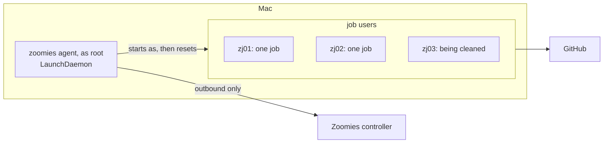

# macOS runners as job users

A Zoomies agent on a Mac can run each job as a local account of its own, with
that account's home wiped after the job. There is no virtual machine, so a job
starts in about a second, as many jobs run at once as you choose (not the two
that Apple's licence allows macOS VMs), and the host's own Xcode, Homebrew and
runner are what the job uses.

This mode gives each job a clean account and keeps the jobs and the agent's
secrets apart. **It does not restrict the network at all.** A job can reach the
LAN, the tailnet and anything else the Mac can reach. Use it only for private
repositories you trust, and never for a runner group that allows public
repositories or forks you do not trust. For that, use [VM isolation](vmpal.md).

## How it works

The agent runs as root, as a LaunchDaemon, and keeps a small set of accounts,
`zj01` to `zjNN`: one for each job you allow at once, and one more, so that an
account being cleaned never keeps a new job waiting. For each job it:

1. reserves the lowest free account that is healthy;
2. checks the account is clean, and resets it if it is not;
3. clones the runner from its own release cache into the account's home and gives
   it to the account;
4. starts the runner as that account, in its own process group.

When the job ends, the agent keeps the runner's `_diag` folder, resets the
account and gives it back. The reset stops every process of the account, boots
out its launchd domains, removes its cron and `at` jobs, unmounts anything the
job mounted, clears every file flag, moves its home aside (the trash is emptied
later, off the next job's path, and never through a mounted filesystem) and makes
a new one, removes its per-user temporary folder, its files in `/private/tmp`,
`/private/var/tmp`, `/Library/Caches` and `/Users/Shared`, and its shared memory
and semaphores, and then checks that nothing is left. A reset that fails takes the
account out of service and the Hosts page says which and why; the agent tries it
again after a minute, after five more, and then every fifteen, so a passing cause
clears itself.



## What it does and does not do

| What | Result |
| --- | --- |
| The agent's credentials and configuration | Out of reach: they are root's, mode 0600 and 0700, and the agent refuses to start if they are not. Each job account has a primary group of its own, because every local account is otherwise in `staff` and macOS homes are readable by that group. |
| Another job's files | Out of reach while it runs (the homes are 0700 and the accounts are different), and gone after it: the home, temporary folders, launchd jobs, keychains and shared memory are wiped. |
| The network | **Not restricted.** Jobs can connect to the LAN, the tailnet, the Mac's own services and the internet, and to services listening on loopback. |
| World-readable files anywhere on the disk | **Readable.** Nothing secret may be world-readable on a host in this mode. |
| CPU, memory and disk | **No limits.** macOS has nothing like cgroups; the number of accounts is the only control. |
| Files left in other world-writable places, and POSIX shared memory | Not cleaned. The trees that are cleaned are the world-writable ones on a stock install we checked (`/private/tmp`, `/private/var/tmp` and `/Users/Shared`), and `/Library/Caches`. To see what else on your Mac is, run `find / -xdev -type d -perm -0002`. POSIX shared memory lasts until reboot. |
| Kernel or set-user-ID exploits | Not defended. |
| The agent itself | It is a root process. It makes only outbound connections and has no listener. A bug in it is root on the host. |

Other differences from a VM clone:

* **No GUI session.** Job accounts never log in, so simulator and UI tests do not
  work. Builds, `swift build`, `codesign` and keychain work do.
* **Empty home every job.** SwiftPM packages, DerivedData and setup actions' tool
  caches are fetched again each time, unless the pool keeps [a cache folder](#a-cache-that-survives-the-reset)
  outside the home. Xcode, the Command Line Tools, Homebrew and its formulae, and
  the runner are shared and stay.
* **No `brew install` in a job.** Homebrew belongs to the admin account. Use setup
  actions, or install into the job's own home.
* **Ephemeral pools only.** A pool that is not ephemeral is refused, and so is a
  non-zero `agent.finished_retention`: either would keep one account across jobs,
  which is the leak this mode removes.

## Enrolling a Mac

You need the `zoomies` binary at `/usr/local/bin/zoomies`, owned by root, in
folders only root can write. The agent refuses to start otherwise, because it runs
as root and starts every job from that file.

1. Join as root. The agent's configuration, credentials and work folder go under
   `/Library/Application Support/zoomies` (root, 0700), and the LaunchDaemon is
   written to `/Library/LaunchDaemons/sh.zoomies.agent.plist` with that folder as
   `ZOOMIES_CONFIG_DIR` and `ZOOMIES_STATE_DIR`:

    ```sh
    sudo zoomies agent join https://zoomies.example.com --token zoojoin_... \
      --process-isolation user --capacity 4
    ```

    The host is given the label `isolation=user`.

2. Point a pool at it. A pool for these hosts uses `backend: process`,
   `platform: macos/arm64` and a `host_selector` of `isolation=user`.

Capacity is `agent.capacity`, at most 47. The host has one account more than that,
and the agent makes them when it starts. The accounts have the login shell
`/usr/bin/false`, so nobody can log in as one, and an existing account with another
shell is corrected (a job still gets `SHELL=/bin/zsh` in its environment). The agent
refuses to start if an account called `zjNN` exists with another UID, primary group
or home folder than `/Users/zjNN`, or is a member of `admin`, or if a UID from 651
to 698 belongs to an account it did not make, so it never adopts a person's account.
The group is `_zjobs` (GID 650).

The controller leaves the capacity of this host alone: it is sized by the accounts,
not by the Mac's cores and memory, so `auto_adjust` does not apply.

Each running job still reports its CPU and memory, as a container does. The agent
adds up every process its account is running: CPU as percent of one CPU (a job
using two cores reads about 200) and the resident memory of those processes, which
counts a page two of them share twice. CPU is the figure `ps` gives, which macOS
smooths over the process's recent past, so it lags a sudden change. Memory has no
limit to compare against, so only the use is shown.

## What a Mac reports

The host itself reports its usage as a Linux host does, so its card, its history
and the problems that read them have figures to work from: CPU busy, the
one-minute load average and the memory available. The agent has no cgo, so each
comes from the nearest thing it can reach:

| Figure | Where it comes from |
| --- | --- |
| Load average | The `vm.loadavg` sysctl, as the kernel keeps it. |
| Memory available | The kernel's page counters: free pages plus the file-backed and purgeable ones, which macOS gives back under pressure. It is the same idea as Linux's `MemAvailable`, and far above the "free" a Mac shows, which macOS keeps near zero on purpose. |
| CPU busy | The stock `/usr/bin/top`, run in the background for two samples five seconds apart, at most once in ten seconds. macOS keeps its per-CPU tick counters behind an interface a static binary cannot call and has no sysctl for them, so there is nothing cheaper to read. The figure is the busy share over that five-second window, not an average over the heartbeat, so it moves faster than a Linux host's. |
| I/O wait and steal | Not reported. macOS has neither counter, so the host card shows them as absent, which is not the same as zero. |

The first heartbeat after the agent starts has no CPU figure, because the first
`top` run has not finished; the next has. A figure is reported only while the
CPU count and memory the agent was given are this Mac's, so a Mac whose Docker
runs in a smaller virtual machine reports nothing rather than the wrong
machine. If `top` cannot run, CPU is absent and the other two still report.

The controller reads these figures as it reads any host's: memory admission,
the throttle and the problems that look at pressure all apply to a Mac now.
Switch `scheduler.host_throttling` off if you do not want a Mac's slots reduced
by what it measures. The memory valve (elastic memory) still needs Linux.

## A cache that survives the reset

Wiping the home means a Swift job fetches and resolves its packages and compiles
everything from nothing each time. Turn the pool's cache on (`cache.enabled`) and
each account gets one folder that the reset leaves alone. The job is told where it
is in `ZOOMIES_CACHE_DIR`, and a workflow uses it by pointing its build there:

```yaml
- run: swift build --scratch-path "$ZOOMIES_CACHE_DIR/$TRUST/$VARIANT/$HASH"
```

Nothing else moves. `XDG_CACHE_HOME` and every tool's own cache stay in the home
and are wiped as before, so a workflow opts in by using the folder and no tool
shares anything it was not told to. With the pool's cache off, nothing changes: no
folder is made and the variable is not set.

* **Where.** `/Users/.zoomies-cache/zjNN`, owned by that account and closed to
  every other (mode 0700), beside the trash and on the same volume as the homes.
  It is outside the home, and outside every folder the reset sweeps for files the
  account owns (`/private/tmp`, `/private/var/tmp`, `/Library/Caches` and
  `/Users/Shared`), so the reset neither moves nor deletes it. It still fails
  on anything else the account left behind. Before each job the agent gives the
  folder back to the account and closes it again, in case the last job opened it.
* **One folder for each account, not one for the host.** A folder with one owner
  keeps what the reset is for: one job user can never write another's files. The
  price is that a job finds only what an earlier job on the same account saved, so
  with several accounts the cache warms up once for each.
* **Size.** Each account's folder is kept under the pool's cache size limit, or
  10 GiB where the pool sets none, so the most a host uses is that figure times
  the number of accounts. The agent prunes just before a job starts and never
  while a job is running in the account. It deletes whole entries, the one
  written to longest ago first, where an entry is what is directly inside the
  folder and its age is the latest write to anything in it. If what is left is
  one folder and it is still over, it weighs the entries inside that folder the
  same way. So put each scratch folder in a folder of its own, and a recent one is
  kept while a stale one goes. It is a ceiling on how far over a folder is when a
  job starts, not a quota: a single job can still fill the disk. The pool settings
  accept a size limit only with an absolute cache `source`, which this mode does
  not use for the folder; give it any absolute path.
* **A cache is only an accelerator.** If the agent cannot make or prune the folder
  it says so in its log, runs the job without `ZOOMIES_CACHE_DIR` and the job
  carries on. A workflow that needs the folder should check the variable is set.
* **Rolling back.** `job-users remove` deletes the cache folders with the
  accounts.

**The trust trade-off.** The folder lasts across every job that lands on that
account, whatever its trust level: a pull request from a branch and a build of
`main` can run one after the other as the same account. A job can write anything
to the folder, so a later job that reads it trusts what an earlier one left. A
workflow that cares must put the trust level in the path itself, with a name for
`main` and a separate one for each pull request or run (as in `$TRUST` above),
and read only the folder for its own level. The agent cannot do that for it, as it
does not know what the workflow keeps there. This is one more reason this mode is
for repositories you trust.

## Checking it works

Run a probe workflow on the host's label that runs two jobs one after the other.
The first should check that it cannot list the agent's configuration, state and
work folders, and has a home that holds only what `createhomedir` makes. It should
then print its user ID and leave a file in `/tmp`, a background `sleep` and a
launchd agent. The second, on whichever account it gets, should check that no
process of the first job's user remains, that the file is gone and that
`launchctl print user/<uid>` finds no agent.

To look for files a job could read outside its home, list world-readable files
under the homes:

```sh
sudo find / -xdev -perm -o+r -type f -path '/Users/*' 2>/dev/null
```

## Rolling back

Stop the agent's LaunchDaemon, restore the previous configuration and service, and
point the pool back at its earlier label. The accounts can stay. To remove them:

```sh
sudo launchctl bootout system/sh.zoomies.agent
sudo zoomies agent job-users remove
```

`job-users remove` refuses while the LaunchDaemon is loaded. It stops everything the
accounts run and deletes the accounts, their homes, the trash, the cache folders
and the group. It
refuses if any account or group in its range is not one Zoomies made.

## Updating the agent

Update the binary by hand and restart the LaunchDaemon, as for VM hosts. Running
jobs survive an agent restart: the next agent finds them from their records and
resets their accounts when they finish.

## Problems this mode can raise

The configuration refusals are `agent.job_users_not_macos`,
`agent.job_users_embedded`, `agent.job_users_finished_retention` and
`agent.job_users_capacity`; each is described in
[the problem codes](problem-codes.md#configuration-the-agent). The Hosts page also
shows which accounts are out of service and why.
