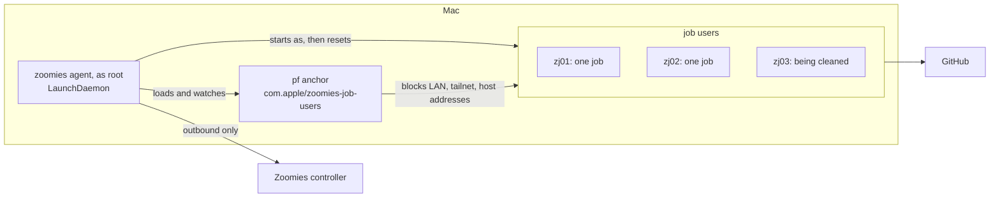

# macOS runners as job users

A Zoomies agent on a Mac can run each job as a local account of its own, with
that account's home wiped after the job. There is no virtual machine, so a job
starts in about a second, as many jobs run at once as you choose (not the two
that Apple's licence allows macOS VMs), and the host's own Xcode, Homebrew and
runner are what the job uses.

It is **weaker than [VM isolation](vmpal.md)**. Read [what is and is not
isolated](#what-is-and-is-not-isolated) before you use it.

## How it works

The agent runs as root, as a LaunchDaemon, and keeps a small set of accounts,
`zj01` to `zjNN`: one for each job you allow at once, and one more, so that an
account being cleaned never keeps a new job waiting. For each job it:

1. reserves the lowest free account that is healthy;
2. checks the account is clean, and resets it if it is not;
3. checks that its firewall rules are still loaded and that the account's network
   behaves as the policy says (see [the firewall](#the-firewall));
4. clones the runner from its own release cache into the account's home and gives
   it to the account;
5. starts the runner as that account, in its own process group.

When the job ends, the agent keeps the runner's `_diag` folder, resets the
account and gives it back. The reset stops every process of the account, boots
out its launchd domains, removes its cron and `at` jobs, unmounts anything the
job mounted, clears every file flag and moves its home aside (the trash is emptied
later, off the next job's path, and never through a mounted filesystem) and makes a
new one, removes its per-user temporary folder, its files in `/private/tmp`,
`/private/var/tmp`, `/Library/Caches` and `/Users/Shared`, and its shared memory
and semaphores, and then checks that nothing is left. A reset that fails takes the account out of
service and the Hosts page says which and why; the agent tries it again after a minute, after
five more, and then every fifteen, so a passing cause clears itself.



## What is and is not isolated

Job users are for **your own private repositories' CI**. They contain mistakes and
leftovers and keep the agent's secrets out of reach. They do not stop a determined
attacker with a kernel or set-user-ID exploit, and Zoomies cannot see which
repositories a runner group allows, so use this mode only for runner groups that
do not allow public repositories or forks you do not trust.

| What | Result |
| --- | --- |
| The agent's credentials and configuration | Out of reach: they are root's, mode 0600 and 0700, and the agent refuses to start if they are not. Each job account has a primary group of its own, because every local account is otherwise in `staff` and macOS homes are readable by that group. |
| Another job's files | Out of reach while it runs (the homes are 0700 and the accounts are different), and gone after it: the home, temporary folders, launchd jobs, keychains and shared memory are wiped. |
| The network | Blocked to the LAN, the tailnet, link-local addresses and every address of the host itself except loopback, for these accounts only; and all IPv6 except `::1`. The public IPv4 internet stays open. |
| A job's own servers on 127.0.0.1 | Work. A job can also reach services listening on loopback or on all addresses, so keep such services on unix sockets with owner-only permissions, or add their ports to `egress_must_block`. |
| World-readable files anywhere on the disk | **Readable.** Nothing secret may be world-readable on a host in this mode. |
| CPU, memory and disk | **No limits.** macOS has nothing like cgroups; the number of accounts is the only control. |
| Files left in other world-writable places, and POSIX shared memory | Not cleaned. The trees that are cleaned are the world-writable ones on a stock install we checked (`/private/tmp`, `/private/var/tmp` and `/Users/Shared`), and `/Library/Caches`, which is cleaned because a job can write there where it is world-writable. To see what else on your Mac is, run `find / -xdev -type d -perm -0002`. POSIX shared memory lasts until reboot. |
| Kernel or set-user-ID exploits | Not defended. |
| The agent itself | It is a root process. It makes only outbound connections and has no listener. A bug in it is root on the host. |

Other differences from a VM clone:

* **No GUI session.** Job accounts never log in, so simulator and UI tests do not
  work. Builds, `swift build`, `codesign` and keychain work do.
* **Empty home every job.** SwiftPM packages, DerivedData and setup actions' tool
  caches are fetched again each time. Xcode, the Command Line Tools, Homebrew and
  its formulae, and the runner are shared and stay.
* **No `brew install` in a job.** Homebrew belongs to the admin account. Use setup
  actions, or install into the job's own home.
* **Ephemeral pools only.** A pool that is not ephemeral is refused, and so is a
  non-zero `agent.finished_retention`: either would keep one account across jobs,
  which is the leak this mode removes.

## The firewall

In this mode Zoomies edits pf, which it otherwise only checks, but only its own
anchor, `com.apple/zoomies-job-users`. macOS's stock `/etc/pf.conf` evaluates every
`com.apple/` anchor, so nothing in a file the system owns is edited. The rules
match only the job accounts. They block outbound traffic to:

* IPv4 `10.0.0.0/8`, `172.16.0.0/12`, `192.168.0.0/16`, `100.64.0.0/10` and
  `169.254.0.0/16`;
* all IPv6 except `::1`, because on a dual-stack network every other host has a
  global address as well, which no list of private ranges would cover. A job has
  the IPv4 internet and no IPv6 beyond loopback;
* the host's own addresses on every interface but loopback, written as
  `(name)` so that pf follows an address that changes.

The rules name every job account that exists on the Mac, not only the ones offered
to new jobs. If you lower `agent.capacity` while jobs run and restart the agent, a
job in an account above the new capacity keeps its rules, is stopped with the rest
if the firewall is lost, and has its account cleaned when it ends. That account is
then never offered again.

Name lookups go through the system resolver (`mDNSResponder`), which is not a
job's process and is not affected. A job tool that sends DNS itself, to a resolver
on the LAN or the tailnet, is blocked like any other traffic to those ranges.

The agent compares the loaded rules with what it wrote before every job and every
sixty seconds, and renders them again when the interfaces change. If the anchor is
missing or different while jobs are running, it loads it again, stops every job's
processes, holds the host for ten minutes and says so on the Hosts page.

Before every job it also runs the same egress check the VM mode does, as the
account the job will use: each `egress_must_allow` target must connect, and each
`egress_must_block` target must first be reachable from the agent itself and then
time out as the account, or fail with "no route" (the kernel's own answer for a
packet the firewall drops). The account runs on the same host over the same routes
as the agent, so the firewall is the only difference between the two. A connection
or a refusal by the target is a breach, and holds the host and stops every job. A
job that the firewall check passed, but that was being made when the firewall was
found lost, is not started.

The VM mode also holds a host when three runners in a row exit without taking a
job. That breaker is not used here: nothing outside the job's own home can show
that a runner took a job, and a job can delete the evidence inside it.

## Enrolling a Mac

You need the `zoomies` binary at `/usr/local/bin/zoomies`, owned by root, in
folders only root can write. The agent refuses to start otherwise, because it runs
as root and starts every job from that file.

1. Write the egress lists to a file. Both are required, and a block target is an
   IPv4 literal with a port, so that no resolver can make the check pass:

    ```yaml
    agent:
      job_users:
        egress_must_allow: ["github.com:443"]
        egress_must_block: ["198.51.100.10:22", "203.0.113.7:443"]
    ```

2. Join as root. The agent's configuration, credentials and work folder go under
   `/Library/Application Support/zoomies` (root, 0700), and the LaunchDaemon is
   written to `/Library/LaunchDaemons/sh.zoomies.agent.plist` with that folder as
   `ZOOMIES_CONFIG_DIR` and `ZOOMIES_STATE_DIR`:

    ```sh
    sudo zoomies agent join https://zoomies.example.com --token zoojoin_... \
      --process-isolation user --job-users-config job-users.yaml --capacity 4
    ```

    The host is given the label `isolation=user`.

3. Point a pool at it. A pool for these hosts uses `backend: process`,
   `platform: macos/arm64` and a `host_selector` of `isolation=user`.

Capacity is `agent.capacity`, at most 47. The host has one account more than that,
and the agent makes them when it starts. The accounts have the login shell
`/usr/bin/false`, so nobody can log in as one, and an existing account with another
shell is corrected (a job still gets `SHELL=/bin/zsh` in its environment). The agent
refuses to start if an account called `zjNN` exists with another UID, primary group
or home folder than `/Users/zjNN`, or is a member of `admin`, or if a UID from 651
to 698 belongs to an account it did not make, so it never adopts a person's account.
The group is `_zjobs` (GID 650).

The controller leaves the capacity of this host alone: it is sized by the accounts,
not by the Mac's cores and memory, so `auto_adjust` does not apply.

## Checking it works

Run a probe workflow on the host's label that runs two jobs one after the other.
The first should check that it cannot list the agent's configuration, state and
work folders; cannot connect to a LAN host, to your controller's address or to the
host's own SSH port; can reach `github.com` and a server it starts on 127.0.0.1;
and has a home that holds only what `createhomedir` makes. It should then print
its user ID and leave a file in `/tmp`, a background `sleep` and a launchd agent.
The second, on whichever account it gets, should check that no process of the first
job's user remains, that the file is gone and that `launchctl print user/<uid>`
finds no agent.

To look for files a job could read outside its home, list world-readable files
under the homes:

```sh
sudo find / -xdev -perm -o+r -type f -path '/Users/*' 2>/dev/null
```

## Rolling back

Stop the agent's LaunchDaemon, restore the previous configuration and service, and
point the pool back at its earlier label. The accounts and the anchor can stay.
To remove them:

```sh
sudo launchctl bootout system/sh.zoomies.agent
sudo zoomies agent job-users remove
```

`job-users remove` refuses while the LaunchDaemon is loaded. It stops everything the
accounts run, deletes the accounts, their homes, the trash and the group, empties
the anchor and releases pf's reference. It refuses if any account or group in its
range is not one Zoomies made.

## Updating the agent

Update the binary by hand and restart the LaunchDaemon, as for VM hosts. Running
jobs survive an agent restart: the next agent finds them from their records and
resets their accounts when they finish.

## Problems this mode can raise

The configuration refusals are `agent.job_users_not_macos`,
`agent.job_users_embedded`, `agent.job_users_finished_retention`,
`agent.job_users_invalid` and `agent.job_users_capacity`; each is described in
[the problem codes](problem-codes.md#configuration-the-agent). The Hosts page also
shows why a host is held, and which accounts are out of service and why.
