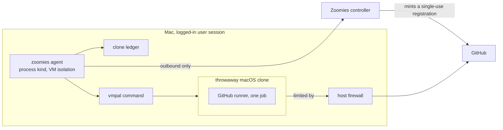

# macOS runners in throwaway VMs

A Zoomies agent on a Mac can run every job in its own new macOS virtual machine
instead of on the Mac itself. The agent clones a prepared VM, checks from inside
the clone that its network is limited, starts a one-job runner in it, and
deletes the clone afterwards. Nothing a job leaves behind reaches the next job,
and a job acts as a user inside a guest, not as your account on the Mac.

This page is for an operator running their own Mac. It uses [VMPal](https://vmpal.app),
a Mac hypervisor app, driven only through its documented `vmpal` command.

## What this is, and what it is not

* **VM isolation behind the `process` kind.** The controller needs no change and
  no database change. To it, the Mac is an ordinary host that offers the
  `process` backend, and a pool that selects it uses `backend: process` and
  `platform: macos/arm64`. On this host, "process" always means "a process inside
  a throwaway VM".
* **How it shows in the UI.** The host's backend is shown as **process**, with a
  detail line that says macOS VM clones. Per-runner CPU and memory are not
  reported, because the agent cannot see inside a guest. Host CPU and memory
  pressure holds are not available on macOS, so capacity is fixed instead (see
  [Capacity](#capacity-and-apples-limit)).
* **Everything lives in the agent on the Mac.** No GitHub App key and no
  controller credential enters a guest. The controller mints a single-use
  registration for each runner as it always does, and the agent holds it in
  memory until the clone has passed its network check.
* **Not a firewall.** Zoomies checks the host's network policy and never edits
  it. Keeping that policy correct is your job, and the section on
  [the host firewall](#the-host-firewall-and-the-policy-check) says what it must
  guarantee.
* **Not for Linux or Windows guests**, and not a way to keep caches between
  jobs: every clone starts from the template.



## Prerequisites

* An Apple silicon Mac that stays powered, awake and logged in. The agent runs
  as that user's LaunchAgent, so there has to be a logged-in session.
* VMPal installed, with its `vmpal` command at the path `agent.vmpal.binary`
  names (by default where VMPal installs it).
* A prepared template (below).
* A host firewall policy and a policy check (below).
* A Zoomies agent build that you update by hand (see
  [Updating the agent](#updating-the-agent-by-hand)).
* Zoomies agent configuration in a file. See [Configuration](configuration.md#agent)
  for the `agent.process_isolation` and `agent.vmpal.*` settings.

## The template

The **template** is the shut-down VM that every clone is made from. It must be:

* a shut-down, installed macOS guest;
* with VMPal's agent control on, and VMPal Tools 0.34 or later installed, so that
  `vmpal exec` works in a clone;
* an account that VMPal can sign in, so that a logged-in session exists in each
  clone (runner work that touches the keychain needs one);
* able to run `/usr/bin/perl`, which the network check uses inside the guest.

It may hold a runner archive cache at
`/Library/Caches/zoomies/actions-runner-osx-arm64-<version>.tar.gz`. Without
one, the guest downloads the archive from GitHub. Either way the guest checks the
archive's SHA-256 before unpacking it, using `agent.runner_sha256` or the
built-in table, and a clone with no known digest fails. The unverified-download
override that exists for the process backend does not apply to guests.

Zoomies never starts, edits or shuts down the template. Cloning works only on a
shut-down VM, so while you have the template running for a re-bake, the backend
reports itself unavailable and says the template is running, and no clone is
made. Zoomies does not touch the template or any other VM it did not clone.

Every clone inherits the template's VM account password, which VMPal keeps on
the Mac. A job with root can change it inside its own clone, but do not reuse
that password anywhere else.

## The host firewall and the policy check

A job has root in its guest, so the limits on what it can reach are enforced by
the Mac and verified before anything reaches the guest. Zoomies does not manage
the firewall. It requires you to supply a policy and a way to attest it.

### What the policy must guarantee

The firewall must, for clones on the guest network:

* allow what a job needs (DHCP, DNS to the gateway, the public internet and any
  service you list as a must-allow target);
* block the Mac itself, your LAN and your private networks, other than what you
  chose to allow;
* cover **IPv4 and IPv6**. A policy with IPv4 rules only leaves IPv6 link-local
  and routable addresses open, and a guest can reach the Mac that way;
* cover **every candidate bridge**. A clone's bridge number is not stable and the
  bridge exists only while a VM uses it, so the rules must already apply to
  every bridge a clone could get before it boots;
* **match the bridge and drop other source addresses**. A job with root can
  change its guest's address, so a rule that trusts the source address alone is
  bypassed by a spoofed one;
* stop one clone reaching another over the shared network, for IPv4 and IPv6.
  Until you have shown that on your Mac, run one clone at a time.

### The policy check

`agent.vmpal.policy_check` is an absolute path to an executable on the Mac that
you supply. It must be read-only, exit 0 only when the firewall is in force for
IPv4 and IPv6 on every candidate bridge, and exit non-zero otherwise. The agent
runs it after a clone boots and before anything is delivered. IPv6 is never
judged from inside the guest, because a guest-side IPv6 test can give a false
pass in the first seconds after boot. A missing, failing or hung check counts as
inconclusive.

### The egress check

Before a clone receives anything from a job, the agent tests the path its
traffic takes. Every condition must hold in the same run:

1. Each **must-allow** target (`host:port`, for example GitHub) connects from the
   guest.
2. For each **must-block** target (an IP literal `host:port`, covering at least
   one LAN and one private-network address), the Mac connects to it first. If the
   Mac cannot, the target may simply be down, so the check fails as
   inconclusive. The guest's attempt must then time out. A connection or a
   refusal is a breach, and any other result is inconclusive.
3. The policy check exits 0.

| Result | Meaning | What Zoomies does |
| --- | --- | --- |
| Breach | The policy is not in force | Deletes this clone and every other clone on the host, holds new work, and says why on the host's page |
| Inconclusive, or a must-allow target failed | Lost connectivity, or a dead target | Deletes this clone and holds new work. Other clones continue |

During a hold, creating a clone is refused at once and the backend reports
itself unavailable. The agent re-probes on its next heartbeat. The next create
after the hold (10 minutes) runs the check again, and holds survive an agent
restart.

The check is a point-in-time test. A firewall flushed after it passes is not
noticed until the next clone. Test the adversarial cases yourself before going
live: from a clone, change the guest's address outside `guest_cidr`, add
link-local and routable IPv6 addresses, and confirm that nothing on your
must-block list and no port on the Mac accepts or refuses a connection. Repeat
the IPv6 attempts through the first minute after boot.

## Enrolment

Enrolment is one path. Run the join as the logged-in user, never as root.

1. Mint a join token with the label `isolation=vmpal` and **no capacity**. A
   token's capacity silently overrides the join request.
2. Write a configuration file for the VM settings (generic example below), then
   run `zoomies agent join` on the Mac with the process isolation option and that
   file. See the [command line reference](cli.md) for the exact flags. The join
   validates the file before it spends the token.
3. In the host's settings, turn `auto_adjust` off and **cordon** the host. No pool
   can reach it yet, because none selects that label.
4. Create the pool with `host_selector: isolation=vmpal`, backend `process`,
   platform `macos/arm64`, ephemeral mode and your labels, then uncordon the host
   and prove one real job. The label guards against misplacement and is not
   proof of isolation.

```yaml
agent:
  process_isolation: vmpal
  vmpal:
    template: example-macos-template
    max_vms: 1
    guest_cidr: 192.0.2.0/24
    policy_check: /usr/local/libexec/example-policy-check
    egress_must_allow: ["github.com:443"]
    egress_must_block: ["198.51.100.10:443"]
```

`agent.process_isolation` must be set to `vmpal` **in the config file**. On macOS,
a remote agent refuses to start unless it is, and a value from an environment
variable does not count: a stock binary would ignore the variable and register
the bare `process` backend, running jobs on the Mac itself. A refused start is
the safe failure. Bare-process mode on a Mac has to be requested with `none`.
The agent with VM isolation registers only the VM backend: Docker, Podman and the
bare process backend are not registered.

A host in this mode refuses a non-zero `agent.finished_retention`, because a
finished clone kept for inspection would hold a VM slot that the controller
believes is free. The configuration findings this raises are in
[Problem codes](problem-codes.md).

## Capacity and Apple's limit

Apple allows two macOS VMs to run at once on a Mac, counting VMs from other
apps. The host's capacity is `agent.vmpal.max_vms` (1 or 2), which join sets as
the host's capacity. The agent reports the Mac's disk but not its cores or
memory, so the controller's automatic capacity adjustment has nothing to size the
host from and leaves that number alone. A host enrolled by an older build keeps
the size it reported then, so turn `auto_adjust` off in its settings. Start with one, and raise it to two once you have
shown that clones cannot reach each other and that two creates fit the
provision timeout.

Before each clone the agent counts its own clones plus any macOS VM VMPal lists
that it does not manage and that is not stopped or suspended. If the count
reaches `max_vms`, or Apple's limit, the create returns the usual "backend busy"
answer. A VM that VMPal does not list is found only when starting a clone fails,
and that is treated the same way. If VMs Zoomies does not manage hold every slot,
the backend reports itself unavailable and names them.

Zoomies cannot see CPU or memory pressure on a Mac. Two clones can overcommit
the cores and leave little memory for macOS and any Linux VMs on the same Mac, so
size them for that before raising `max_vms`.

## Clone sizing

A clone takes the template's size unless you say otherwise:

* `agent.vmpal.cpus`: 0 (the default) inherits the template's CPU count,
  otherwise at least 2.
* `agent.vmpal.memory_gb`: 0 (the default) inherits the template's memory,
  otherwise at least 4.

A pool's own size settings do not apply to a VM clone. See
[Configuration](configuration.md#agent) for the keys.

## Sleep, reboot and logout

| Event | What happens |
| --- | --- |
| The agent restarts | Running jobs continue. The agent reads its ledger and adopts live clones, and never replays a registration |
| The Mac sleeps | On wake the agent sees a wall-clock gap of over 3 minutes and deletes the clone rather than resuming it, because its network state is no longer known. The runner is reported failed |
| The Mac reboots | After someone logs in, the agent finds the clone stopped, reports the runner failed and deletes it. It never restarts a clone |
| The user logs out | The agent and its VMs stop. It is handled as a reboot at the next login |
| A guest wedges | The agent deletes the clone at the 6-hour lifetime limit, which ends the job |
| `vmpal` hangs | The call is stopped by its timeout and that step fails |

A Mac that sleeps loses its clones, so keep it awake. After a reboot, nothing
restarts the agent until a user logs in, so decide whether you want automatic
login. That is a trade-off for you: it recovers unattended, but anyone with
physical access to a Mac without disk encryption gets a logged-in session.

Cordoning the host stops new clones. Jobs already running finish and their clones
are deleted. An explicit runner drain follows the usual rule: a busy runner gets
five minutes and then its job is cancelled.

A runner that registers and then dies without taking a job is not covered by the
controller's start-failure backoff, so the agent keeps its own breaker. Three
consecutive runners that exit without taking a job, and were not stopped by the
agent, start a hold of 10 minutes, then 20, 40 and at most 60, so a repeating
failure creates a bounded number of registrations. A runner that takes a job
clears the count.

## Stranded clones

Each clone has a small ledger entry in the agent's work directory, and its VM is
named `zoomies-vm-<install id>-<runner id>`. The agent deletes a clone it owns
after its job, and on its next start it deletes any clone whose job did not
complete before registration, resumes deleting one it had begun deleting, and
reports the rest.

It never touches the template, your other VMs, or a VM carrying another install
ID. If the delete does not finish, the entry stays, the VM keeps counting against
capacity and the next reconcile retries. If a reinstall loses the agent's work
directory, old clones are stranded, and you remove them yourself:

```sh
vmpal list
vmpal delete <name> --force --permanently
```

Only delete a VM whose name begins with `zoomies-vm-` and that you know is
yours. `vmpal` returns from a delete a few seconds before the VM leaves its
list, so check the list again before counting the slot free.

## Updating the agent by hand

The agent on this host is a build that you make and update yourself. It is
stamped with the controller's release, so the controller reports no version skew
and offers no update button.

**Never run `zoomies upgrade` on this host**, and do not use the update helper or
a stock release. A stock binary refuses the configuration file rather than
running bare, but replacing the agent is still the wrong move. Stop the agent,
replace the binary with your own build, and start it again. Running jobs keep
their clones until the new agent adopts them.

## Known limits

* The egress check is a point-in-time test (above).
* The public internet and DNS stay open to jobs, so a job can send out anything
  it can read. Only let repositories you trust reach the pool.
* Every clone inherits the template's account password.
* Whether guests can reach each other over the shared network depends on your
  firewall. Prove it on your Mac before running two clones.
* One Mac is one failure domain: if it is off, asleep or logged out, its pool
  has no capacity.
* The controller raises no problems of its own for this host. Reasons appear in
  the backend detail and in a runner's failure message, and the agent's
  configuration findings have codes in [Problem codes](problem-codes.md).
* Each runner is named by Zoomies, ending in a random token. A workflow that
  parses the native runner name format needs to accept that.
* Per-runner CPU and memory are not reported, and the controller cannot see host
  pressure on a Mac.

See also [Hosts and pools](hosts-and-pools.md#a-mac-in-throwaway-vms), the
[security notes](security.md#a-mac-running-jobs-in-throwaway-vms) and the
[architecture](architecture.md).
